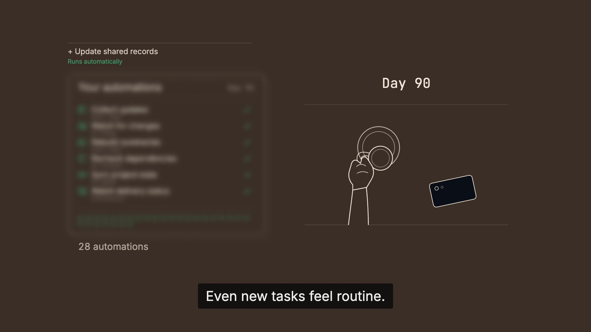
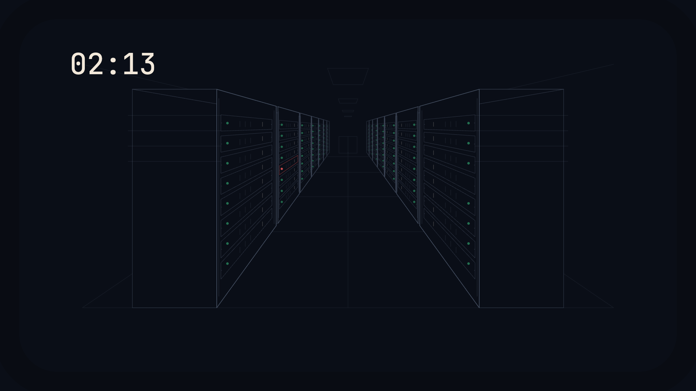
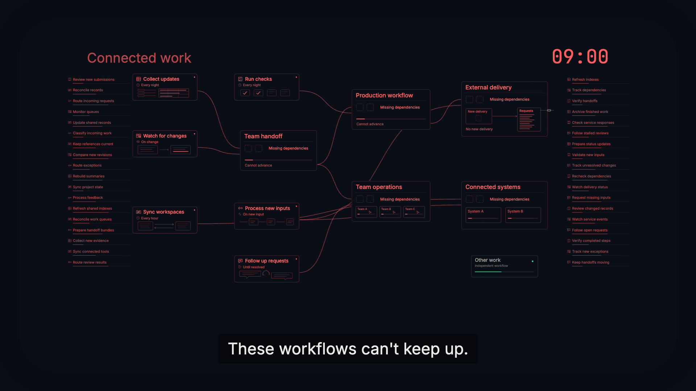
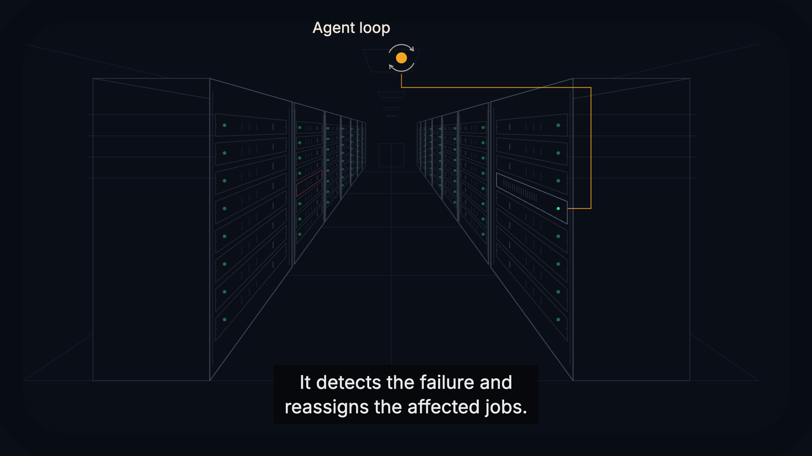
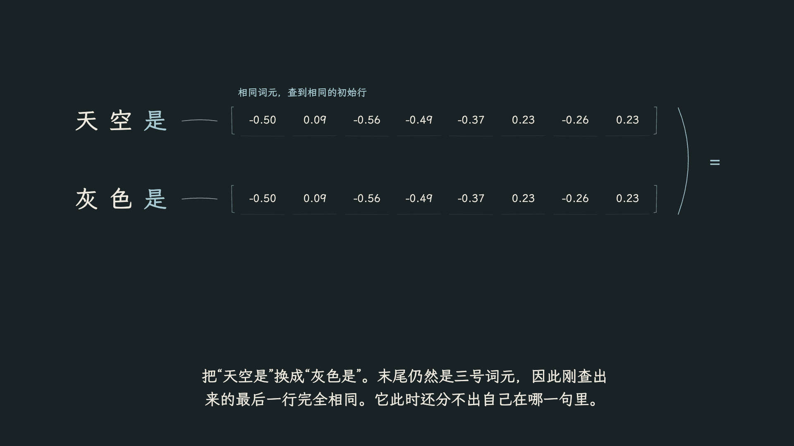
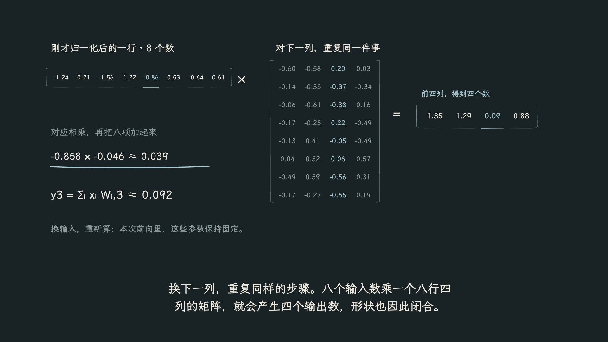
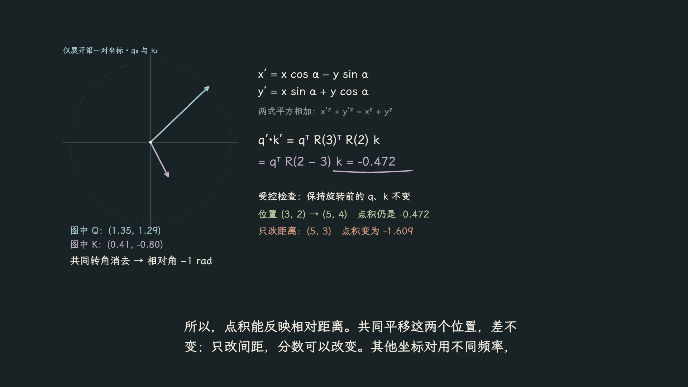
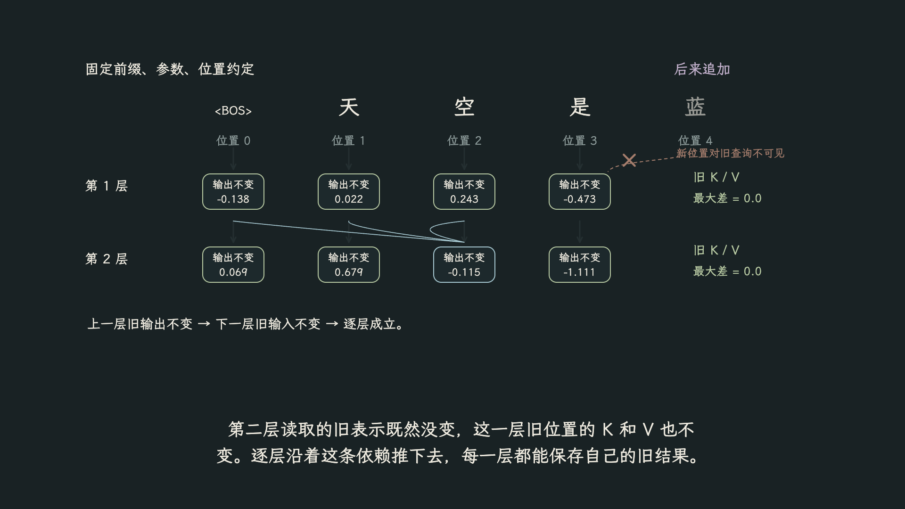

# Direct Story Videos

**把导演的判断写进 Skill，让每一部片子找到自己的表达。**

用于 AI 辅助视频制作的开放工作流：从意图、叙事、视觉和声音，到动作连续性、修订与实际验收。它可以帮助制作解释片、叙事视频与产品动效，也可以只审查或修复现有作品。

An open, judgment-driven skill for AI-assisted video direction. Choose narrative, visual language, transitions, pacing and sound for the current work—not by copying the last video's style. Instructions and workflow documentation are primarily in Chinese.

[动态样例](examples/style-lab/README.md) · [开始使用](#开始使用) · [完整 SOP](制作SOP.md) · [Skill 入口](skills/direct-story-videos/SKILL.md) · [English guide](docs/README.en.md)

## 保存判断，不保存套路

“上一部用了手绘，所以这一部也该用手绘。”这样的继承省掉了最重要的判断。

这个项目记录的是：**想让观众理解或感受什么 → 当前有哪些条件 → 为什么选择这种方法 → 条件怎样变化会让它失效 → 怎样用作品验证。**

| 方面 | 要作的判断 | 不预设的答案 |
| --- | --- | --- |
| 叙事 | 观众通过什么关系进入内容，哪一步缺了因果 | 必有钩子、灾难、高潮、解法 |
| 视觉 | 什么媒介、色彩、形状和信息密度服务本片 | 手绘、黑板或上一部的色板 |
| 转场 | 前后是什么关系，要保留、放下或打断什么 | 全部淡化、全部无感、全部炫技 |
| 节奏 | 理解、表演、观察、音乐或期待，谁决定时间 | 一律加速、固定镜长、每拍都动 |
| 声音 | 哪些职能需要声音，各层怎样分工 | 旁白＋音乐＋音效的固定套餐 |
| 质检 | 当前版本有哪些实际证据，哪些仍没验证 | 测试通过就等于好看、自然或看懂 |

## 八段实际动态样例

新增 [Style Lab](examples/style-lab/README.md)：线描讲解、字体动效、扁平图形表演、纸艺空间、等距流程、像素动作、原生三维拆解、生成式抽象。各有内容、动作与时间组织，合计约 1 分 53 秒；不是同一张图换滤镜，也没有使用生图结果。

克隆后进入 `examples/style-lab`，运行 `npm ci` 与 `npm run dev` 即可播放、逐帧查看和改源码。每段独立注册为可编辑合成，尺寸 1920×1080、30 fps，本轮静音。

下列动图直接播放每段完整动作：**960×540，约 15 fps，12–16 秒，原速循环，静音**。为便于 GitHub 加载使用 GIF，1920×1080 高清 PNG 仍可在样例页查看；源码保持 30 fps。

| 线描机制：看见结构怎样改变 | 字体动效：让注意力获得空间 |
| --- | --- |
| [](docs/motion-studies.md#01--线描机制讲解) | [](docs/motion-studies.md#02--字体动效) |
| 扁平表演：压缩、弹起与到位 | 纸艺空间：跟随船穿过景层 |
| [](docs/motion-studies.md#03--扁平图形表演) | [](docs/motion-studies.md#04--纸艺空间) |
| 等距流程：跟住同一件物体 | 像素动作：起跳与落地的时间 |
| [](docs/motion-studies.md#05--等距流程) | [](docs/motion-studies.md#06--像素动作) |
| 三维拆解：通过转动看见体积 | 生成式抽象：从独立到共同运动 |
| [](docs/motion-studies.md#07--原生三维拆解) | [](docs/motion-studies.md#08--生成式抽象运动) |

点击查看 [完整八段、设计说明与高清原图](docs/motion-studies.md)。安装与合成入口见 [样例说明](examples/style-lab/README.md)，取舍依据见 [导演记录](examples/style-lab/DIRECTING.md)。动图循环回到片头时会重新开始，不是无缝循环设计；本例不声称覆盖所有画风。

## 两部作品，两种表达

以下是制作过程中保存的实际源帧。它们说明项目中的视觉选择，不是新片必须复制的模板，也不是“首次观众已理解”或“作者已满意”的证明。

**全部图片均为 1920×1080 原生 PNG，未放大、未缩小。点击可查看高清原图。** 帧号、尺寸与 SHA-256 见 [图片清单](docs/images/manifest.json)。本仓库发布方法、工具与截图，不包含两部影片的完整源码、音轨或视频文件。

### 01 · Silence / Astra：让看不见的风险进入视野

长期稳定使人不再查看自动化结果，任务却持续增加并互相依赖。镜头从日常的松弛进入云端机房：一个不起眼的故障，逐渐显露它在复杂系统中的影响。

[](docs/images/astra-routine.png)

这里用生活动作、注意力变化、空间进入和前后回扣组织观看；在机制部分再解释外部 loop 与可替换的执行环境。截图中的恢复路径是**架构机制演示**，不作为 Astra 当前产品能力或恢复时限承诺。Astra 是独立项目：[matrixorigin/Astra](https://github.com/matrixorigin/Astra)。

<details>
<summary>展开另外三张高清实帧：隐藏故障 → 连锁影响 → 重新接通</summary>

**人看不见的地方，一个小点出错。**

[](docs/images/astra-hidden-failure.png)

**受到影响的是互相依赖的工作，而不只是一个未完成数字。**

[](docs/images/astra-cascade.png)

**同一机房空间中的回扣：外部连接指向另一个执行节点。**

[](docs/images/astra-recovery.png)

</details>

### 02 · 答案出现之前：让前向计算成为可追踪的变化

“天空是”和“灰色是”，最后的“是”查到相同的初始表示。那前文究竟怎样改变后面的预测？影片跟住这一行数字，逐步展开它的变化，不从组件名清单开始。

[](docs/images/llm-context.png)

这里选择克制的黑板手写，按解释顺序显露数字、乘加与依赖。画面来自可执行的两层微型模型；参数未训练，首步得到“蓝”的种子经过筛选，因此只用它追踪计算机制，不能据此证明语言能力。对应的是一种 Llama 风格的稠密解码器结构，不代表所有模型的统一实现。

<details>
<summary>展开另外三张高清实帧：乘加 → 位置旋转 → 缓存依据</summary>

**一个输出数怎样由输入和一列参数计算出来。**

[](docs/images/llm-multiply.png)

**位置不是一个待背的方框：旋转怎样进入点积。**

[](docs/images/llm-rotation.png)

**后来不改变以前，才有可以复用的旧结果。**

[](docs/images/llm-cache.png)

</details>

## 开始使用

将整个 `skills/direct-story-videos/` 文件夹安装到支持 `SKILL.md` 的智能体环境。以 Codex 的用户目录为例：

```bash
git clone https://github.com/Bai-009/direct-story-videos.git
cd direct-story-videos
mkdir -p ~/.codex/skills
```

将本仓库的 `skills/direct-story-videos` 复制到 `~/.codex/skills/`。如果目标已有同名版本，先比较或备份，不要直接覆盖。其他环境按自己的技能目录约定安装；能读取 Markdown 不等于已适配其所有工具。

然后给出真实内容、观众、交付条件和已有素材，例如：

```text
使用 $direct-story-videos，把这份 brief 制作成解释片。
面向第一次接触这个机制的观众，但不能省掉关键因果。
先判断适合的视觉与声画方式，验证最不确定的一段，再扩展全片。
```

```text
使用 $direct-story-videos，只修这个转场。
保留已接受的画风，检查视线交接、前后含义和共用素材的影响。
```

```text
使用 $direct-story-videos，审查完整影片的逻辑、节奏、动作和声音。
区分实际看过、听过、测量过和仍待确认的内容。
```

不要求每次走完所有阶段。局部修订、只读评审和完整制作采用不同范围；当前明确要求优先于偏好与历史经验。

## 可运行的工作流工具

Python 3.10+，仅使用标准库，不调用外部服务。下面的 `PROJECT` 是你的实际项目目录：

```bash
python3 skills/direct-story-videos/scripts/video_workflow.py init PROJECT
```

它无覆盖地建立 `production/` 工作文件。把 `review-spec.json` 改成实际时轴、列出源码和媒体输入，并将 `example_only` 设为 `false` 后：

```bash
python3 skills/direct-story-videos/scripts/video_workflow.py plan PROJECT/production/review-spec.json
python3 skills/direct-story-videos/scripts/video_workflow.py verify PROJECT/production/review-plan.json
```

`plan` 生成镜头、接缝及动作的待查帧，记录明确列出的输入指纹；`verify` 检查计划和这些输入是否仍匹配。它们**不渲染、不播放、不听辨、不评定审美**，也不会自动发现未列出的素材。完整字段与返回码见 [使用与验证](使用与验证.md)。

## 内容与依赖

```text
skills/direct-story-videos/
├── SKILL.md                 入口与判断原则
├── agents/openai.yaml       Codex 显示与调用信息
├── references/              导演、视觉、声音、连续性、质检与工作流
├── assets/project-template/ 按需采用的工作文件
└── scripts/video_workflow.py
tests/                      工具行为测试
examples/style-lab/         八段可运行的动态样例、字体与锁文件
docs/                       使用说明、验证边界与高清实帧
制作SOP.md                  人可阅读的完整流程
使用与验证.md               命令、字段与验证方法
```

Skill 本身不绑定渲染引擎；实际使用 Remotion 时，需要执行环境可用的对应技术技能、Node.js 和媒体工具。语音、位图生成、渲染与发布能力由各环境另行提供，不打包在这里，也不因调用 skill 就自动获得外发或发布授权。发行版不包含作者个人偏好、私人对话或旧项目档案。

## 验证与贡献

```bash
python3 -B -m unittest discover -s tests -v
```

测试覆盖采样计划、输入变化、缺失文件、时轴边界和无覆盖初始化。通过只证明工具行为，不证明未来每部作品都成立。详细范围见 [验证说明](docs/validation.md)。

欢迎提交具体失败案例与改进：说明当前意图、观看条件、实际结果、误判根因，以及什么反例会改变你的建议。优先改善选择依据，不把一部片子的答案提升为所有片子的规则。见 [贡献约定](CONTRIBUTING.md)。

## 许可

Skill、文档、脚本与动态样例源码采用 [MIT License](LICENSE)。示例截图按 [CC BY 4.0](https://creativecommons.org/licenses/by/4.0/) 提供，署名 Bai-009，详见 [图片说明](docs/images/README.md) 与 [动态样例](docs/motion-studies.md)；不包含第三方商标的授权。打包字体保留各自的 OFL 许可。
