# 实际动态样例

这些动图和源帧来自 [Style Lab 的可运行视频合成](../examples/style-lab/README.md)，画面与运动均由代码绘制。每段都有独立的动作、时间组织和合成入口；每节先播放完整动作的 GIF，再保留三个关键时刻的高清源帧。需要逐帧查看和编辑时进入源码预览。

**高清静帧为 1920×1080 原尺寸 PNG，点击查看；动图为 960×540、约 15 fps 的原速完整片段。** GIF 支持无限循环，重播时直接回到片头；帧延迟受 GIF 的百分之一秒精度限制。八段共 113 秒，静音；源码保持 30 fps。源帧见 [PNG 清单](motion/manifest.json)，动图文件、时长与输入指纹见 [GIF 清单](motion/gifs/manifest.json)。

## 01 · 线描机制讲解

铰接四边形先剪切，再加固定斜杆；不靠标题宣布结构改变。14 秒。采用线条逐步显露与前后状态比较，适用于需要归因的简短机制；本例是理想化二维示意。

| 3 秒：四边保持长度 | 6 秒：停到对照位置 | 10 秒：加入固定斜杆 |
| --- | --- | --- |
| [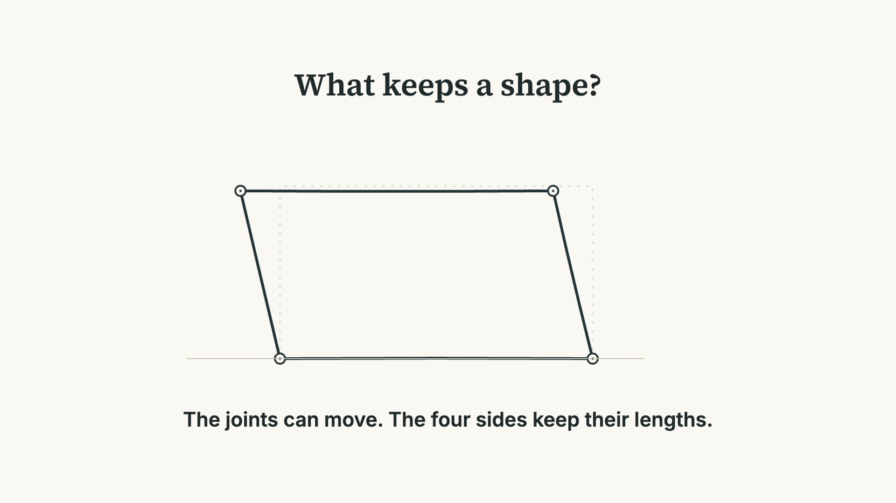](motion/01-ink-step1.png) | [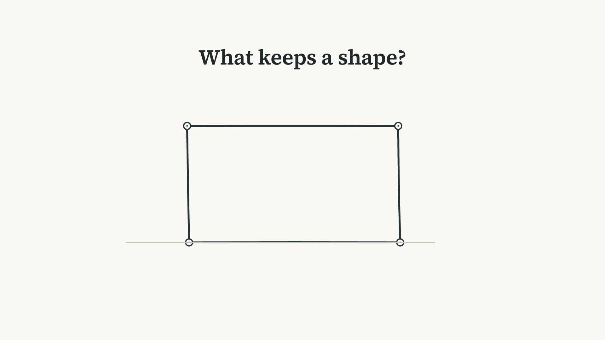](motion/01-ink-step2.png) | [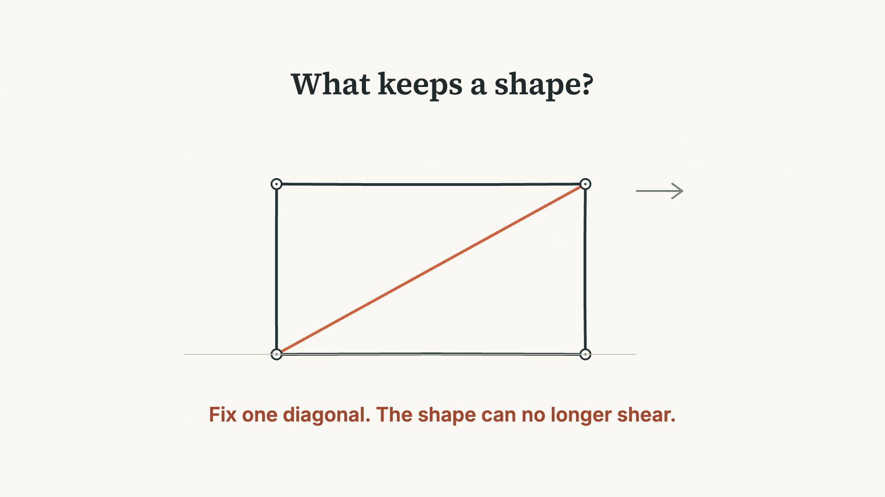](motion/01-ink.png) |

[源码](../examples/style-lab/src/Ink.tsx) · 合成 `01-Ink-Mechanism`

## 02 · 字体动效

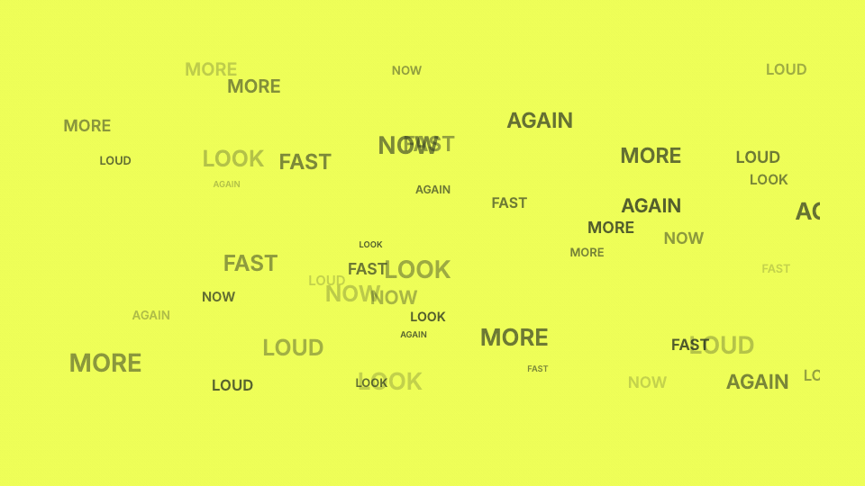

小字分散并退出，焦点字获得空间，随后整组离开再进入结尾。13 秒。用文字的运动与排版变化组织注意力；密集推导不宜沿用这种短语密度。

| 4 秒：分散文字退出 | 8 秒：焦点获得空间 | 约 13 秒：新的排版收束 |
| --- | --- | --- |
| [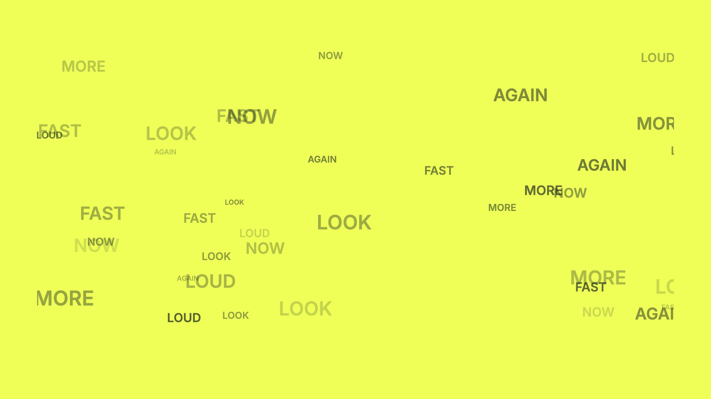](motion/02-type-step1.png) |  | [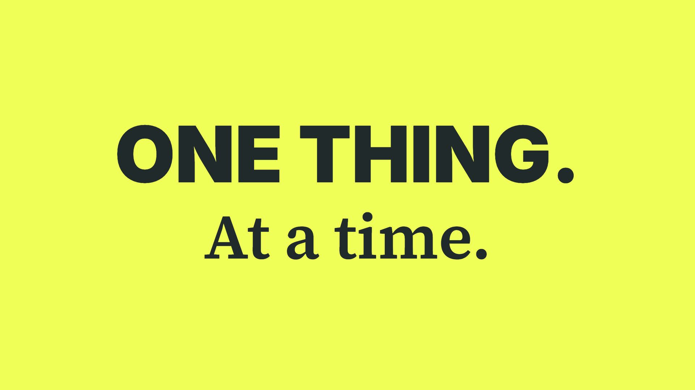](motion/02-type.png) |

[源码](../examples/style-lab/src/Type.tsx) · 合成 `02-Kinetic-Type`

## 03 · 扁平图形表演

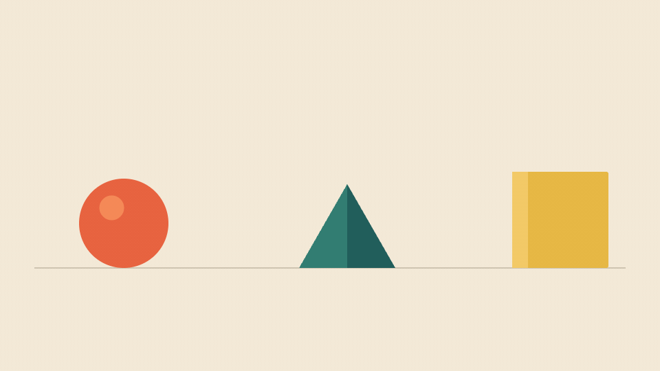

圆形压缩、弹起、到位；方块转动时，其最低角持续与地面相接。12 秒。大色块与简单轮廓让运动成为主体；动作采用风格化夸张，按表演需要安排形变与时间。

| 1.5 秒：准备 | 4 秒：腾空到位 | 10 秒：动作完成 |
| --- | --- | --- |
| [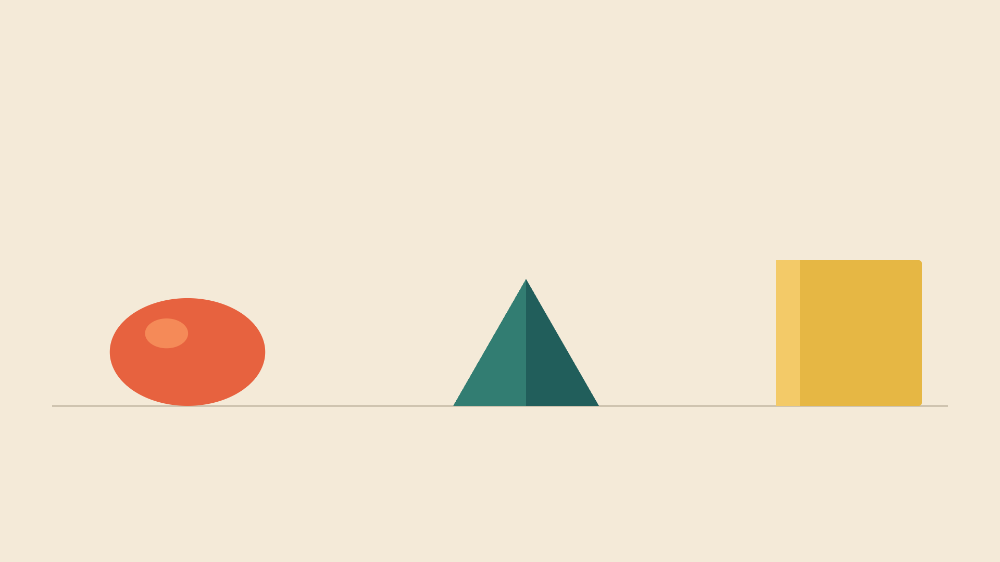](motion/03-flat-step1.png) |  | [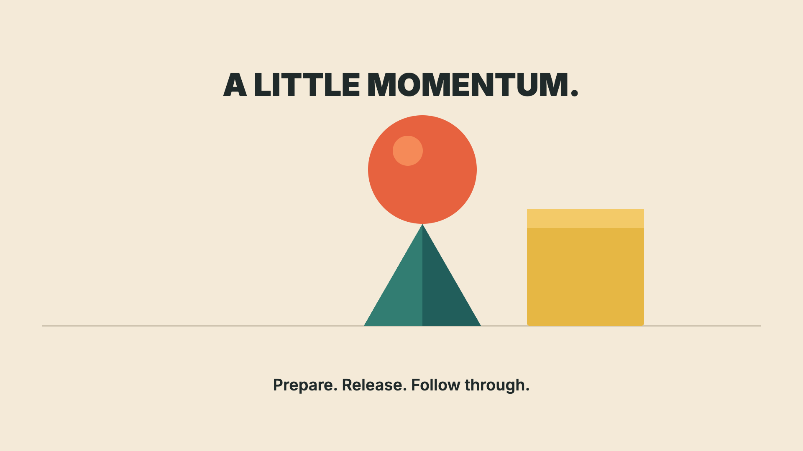](motion/03-flat.png) |

[源码](../examples/style-lab/src/Flat.tsx) · 合成 `03-Flat-Performance`

## 04 · 纸艺空间

折纸船在不同深度的景层中行进，前景山脊经过并遮挡主体，随后进入下一片水域。16 秒。景层、阴影与运动视差承担空间交接；画面由代码绘制为纸艺质感的 2.5D 空间。

| 3 秒：建立位置 | 6 秒：前景接近主体 | 13 秒：下一片水域 |
| --- | --- | --- |
|  |  |  |

[源码](../examples/style-lab/src/Paper.tsx) · 合成 `04-Paper-Space`

## 05 · 等距流程

两件包裹在同一空间坐标中进入、经过门架、离开。14 秒。沿着运动追踪对象身份与交接，投影与遮挡共同保持空间关系。本段用包裹交接演示流程表达，产品能力需另行验证。

| 3 秒：第一件进入 | 6 秒：经过处理位置 | 13 秒：两件保留各自位置 |
| --- | --- | --- |
|  |  |  |

[源码](../examples/style-lab/src/Iso.tsx) · 合成 `05-Isometric-Flow`

## 06 · 像素动作

角色先压低准备，沿弧线跳跃，落地后再压缩。两跳的跨度与时长不同。12 秒；姿态每秒更新 12 次，输出为 30 fps，保留刻意的离散动作与清晰像素边缘。

| 4 秒：第一跳途中 | 6 秒：中间停留 | 10 秒：第二次落地 |
| --- | --- | --- |
|  |  |  |

[源码](../examples/style-lab/src/Pixel.tsx) · 合成 `06-Pixel-Action`

## 07 · 原生三维拆解

先看正面，再让相机转动揭示厚度；六个面沿法线分开，随后重组。16 秒。画面由立方体顶点、透视投影、深度排序与面着色实时计算，呈现简化的三维几何。

| 3 秒：转动揭示厚度 | 8 秒：六面拆解 | 13 秒：重组 |
| --- | --- | --- |
| [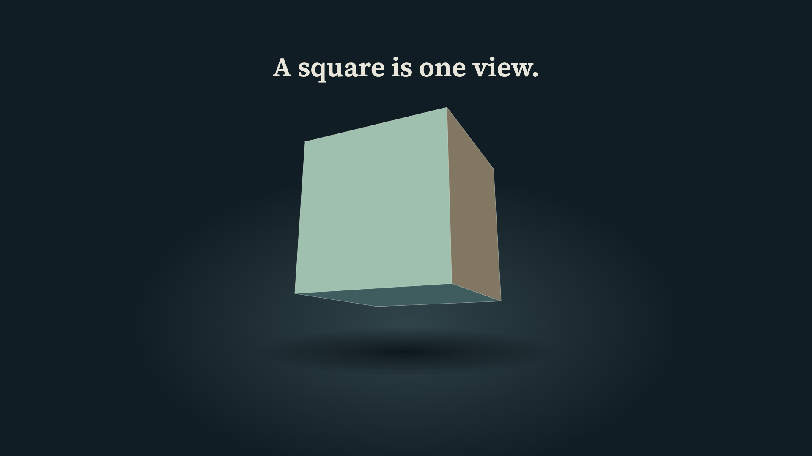](motion/07-mesh-step1.png) | [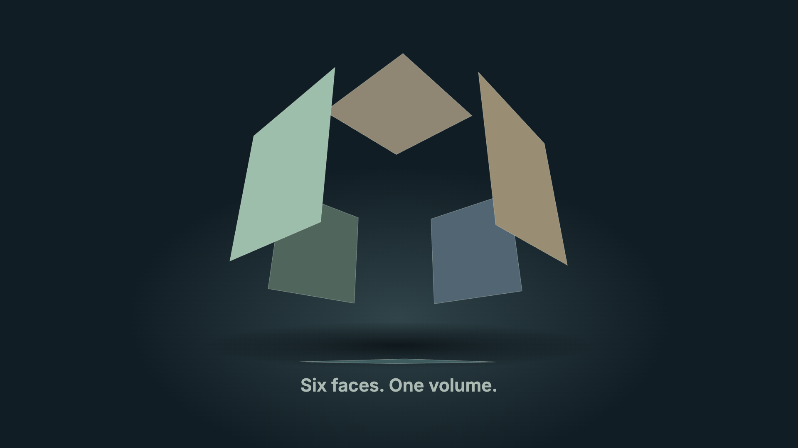](motion/07-mesh.png) | [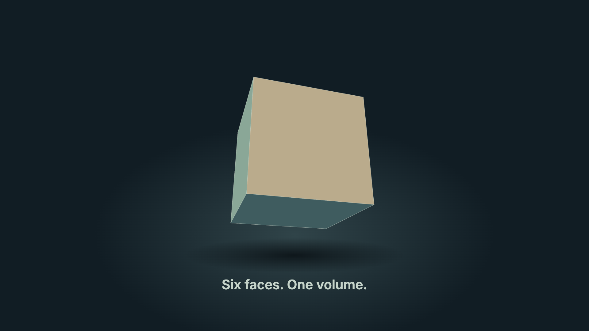](motion/07-mesh-step3.png) |

[源码](../examples/style-lab/src/Mesh.tsx) · 合成 `07-Native-3D`

## 08 · 生成式抽象运动

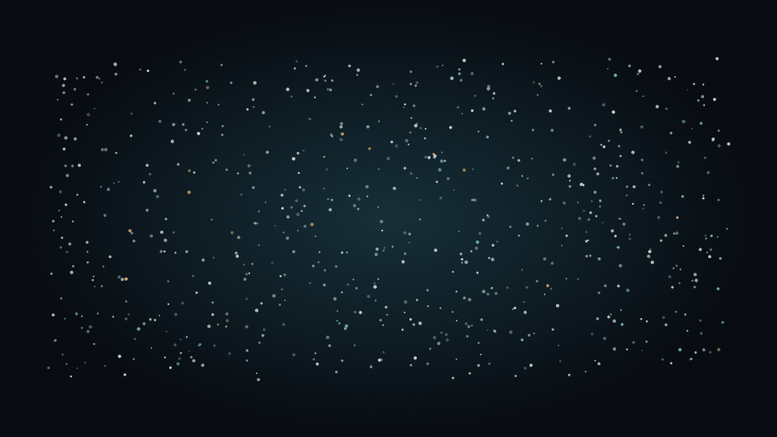

独立粒子逐渐进入同一波形，再连续形成环。16 秒。粒子位置由预设函数生成，通过聚合、相位与疏密变化形成节奏。

| 3 秒：独立运动 | 8 秒：相位波 | 13 秒：形成环 |
| --- | --- | --- |
| [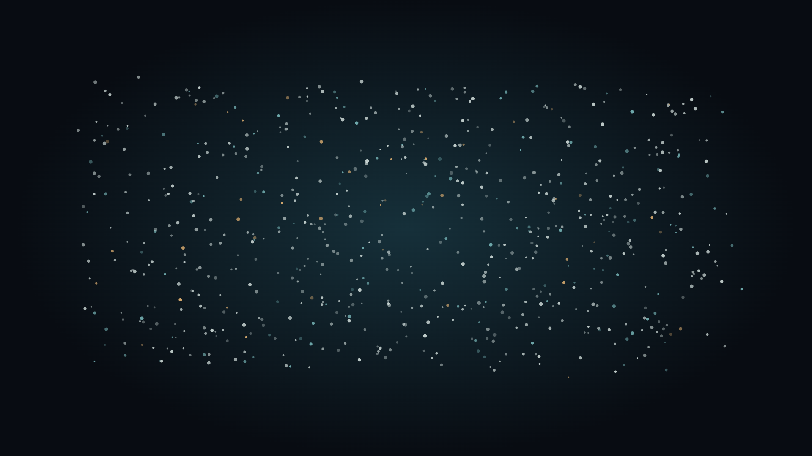](motion/08-field-step1.png) | [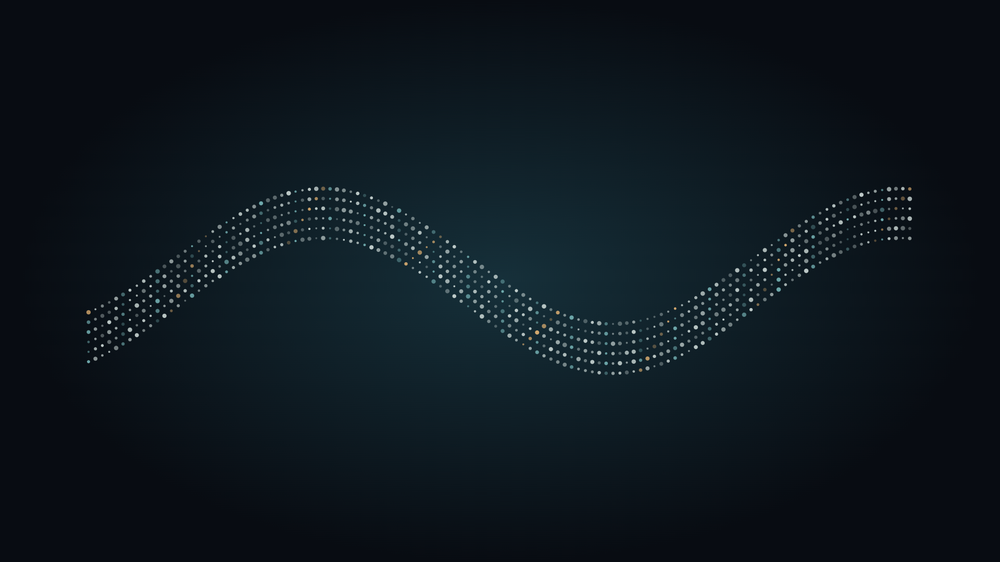](motion/08-field-step2.png) | [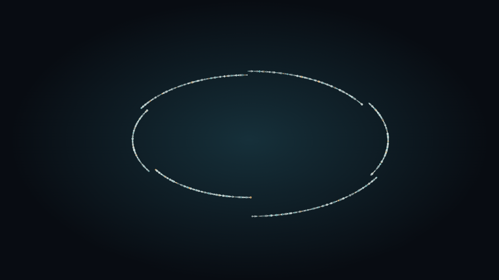](motion/08-field.png) |

[源码](../examples/style-lab/src/Field.tsx) · 合成 `08-Generative-Field`

## 怎样使用这些例子

先明确当前作品希望观众看见什么，再查看例子中的关系、动作和时间依据；不能按题材名对号入座，也不必沿用颜色、字体或运动曲线。完整选择依据及改选条件在 [导演记录](../examples/style-lab/DIRECTING.md)。

本次检查了覆盖全部八段的 72 个源帧；本地联播运行时，实际帧持续推进到最后一段，未显示运行错误。检查范围为上述采样与运行观察；逐帧人工审阅和首次观众理解情况尚待验证。声音未制作，听感不在本轮验证范围。

本页 24 张源帧截图与 8 个源码渲染 GIF 按 CC BY 4.0 提供，署名 `Bai-009 / Direct Story Videos`；源码按仓库 MIT，字体保留其各自许可。原始生图探索没有进入本样例、源码依赖或公开仓库。
