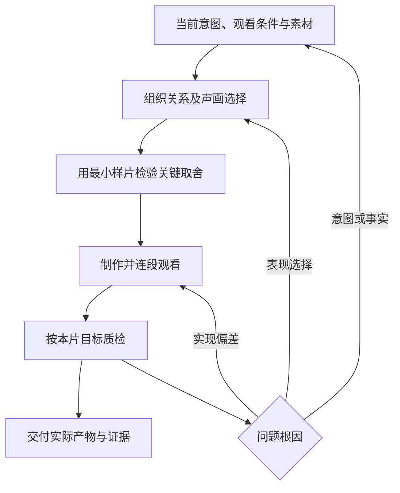

# 视频制作 SOP：把判断落实到作品

调用 `$direct-story-videos`。本流程保存判断能力：面对当前内容决定怎样组织观看、怎样选视觉与声音、怎样验证效果。它不预设故事骨架、剪辑节律、媒介或声轨配置。

## 三类内容分开处理

| 类别 | 怎样使用 |
| --- | --- |
| 当前用户要求、事实与交付约束 | 必须满足；未知主张不能写成实证，未做的检查不能写成通过 |
| 导演与美学选择 | 依据本片内容、受众、观看条件、素材与情绪作判断；允许多种成立方案 |
| 项目取值与历史经验 | 参数留在项目；复用条件、原因辨别和验证方法，不自动复用答案 |

关键选择只需一条有用的推理：**当前效果 → 影响选择的条件 → 采用方法及代价 → 什么变化会让它失效 → 怎样检验。** 不要求每个小决定都填表，也不为证明灵活而刻意改换已适用的选择。

## 从请求决定工作范围

| 请求 | 入口与本轮产物 |
| --- | --- |
| 新片 | 当前意图、观看方式与组织关系；必要的导演草案和风险样片 |
| 整体重构 | 实际理解／体验在哪里偏离目标；对应的新方案与验证 |
| 局部修改 | 根因、改动前后、共享调用及相邻衔接；不自动重做全片 |
| 只读评审 | 发现、依据、影响及修正方向；不自动扩为改片 |
| 质检并修复 | 版本与适用标准、实际修复、复验证据与剩余限制 |



按当前请求进入相应阶段，需要返工时沿依赖关系定位。阶段自检不增加用户审批；仅在缺少会改变结果的信息或必要授权时提问。

## 1．建立当前意图与观看方式

读最新原话、brief、参考、现有产物和纠正，分清有效决定、撤销方案与助手假设。记录观众希望理解、感受、观察或做什么，已有经验如何，在哪里、带不带声音观看，实际交什么。

按 [从事情本身想出画面](skills/direct-story-videos/references/content-to-screen.md) 作第一性推导：先弄清内容为什么会这样，再结合观众已有的信息，找出他需要接上的关系。解释片追踪实际过程，观察或抒情片找值得持续看或听的东西，比较片确认比较条件。涉及产品能力、真实记录或技术机制时另记证据与示意边界。

关键检查：哪些视听线索支撑目标？什么误读会损伤本片？哪些未知或歧义本来就要保留？使用 `production/intent.md` 或现有格式，只记录当前需要的内容。

## 2．一起选择叙事、视觉、转场、节奏与声音

从关键关系找出观众能察觉的变化，说明为什么这个变化支持本片的理解或感受，再组织镜头、转场和声音。可参考 [云端 Agent 与 LLM 的两个推导例子](skills/direct-story-videos/references/content-to-screen-examples.md)，只借用思考方法。对情绪和理解的预测通过实际片段检验；记录按关键问题展开。

| 方面 | 实际要作的判断 | 不能自动采用的答案 |
| --- | --- | --- |
| 叙事 | 观众通过因果、行动、发现、比较、观察或情绪等何种关系进入作品；如何开始与结束 | 必有钩子、悬念、高潮、解法、回扣 |
| 视觉 | 哪种媒介、形状、材质、配色、排版和运动适合当前条件 | 沿用上一支片子的整套外观 |
| 转场 | 两段是什么关系，要保留、放下或打断什么；是否需要切 | 所有转场无感、所有切点淡化或匹配 |
| 节奏 | 哪一层决定当前时间：理解、动作／表演、音乐、口述、期待、观察或聆听 | 必须越来越快、必有主峰、慢段必须加动作 |
| 声音 | 哪些职能需要声音；各层互补、重复、对照还是主导；哪些声部不用 | 默认旁白＋配乐＋拟音，始终人声在前 |

需要时查 [叙事、转场与节奏](skills/direct-story-videos/references/directing.md)、[视觉判断](skills/direct-story-videos/references/visual-direction.md)、[声音](skills/direct-story-videos/references/sound.md)。

用户偏好帮助候选排序，当前意图决定是否适用。手绘可为主体、局部辅助或不采用；它不附送旧色板。相同条件可延续系列，条件改变时重新判断。重复可推进信息，也可建立韵律或仪式；纯静止停留和均匀结构同样可以成立。

## 3．用小样回答真正不确定的问题

根据会影响后续制作的风险决定试片内容与数量。可能需要验证一次概念变化、一段长停留、一个喜剧停顿、一段实物动作、一个复杂接缝或声音关系。

有多个合理方向且差异重要时，用同一内容比较。先确定比较什么：理解、情绪、观察、节律、质感或观看耐心。静帧检查构图与细节，动态片段检查动作、切点和时间；实际听过才评价听感。无人声就不试音，无声片就不制造音轨。

首次观看反馈应尽早进入：不先讲答案，让未读脚本的人实际看，再记录他接收到的关系、感受与疑惑。独立模型只能提供它实际能感知的层面；文字方案、作者推理和自动测量不能冒充观众体验。

## 4．按适合本片的规则制作与修订

按观看关系完整的小段制作，连同前后看片。需要一致的对象身份、状态、几何、映射及时间事件共用依据；现实演示不能出现矛盾事实。

真实物体查支撑、投影、接触和释放；图形变化查身份、映射与语义；风格化动作查已建立的规则和偏离理由。绘制线条、透明或叠化时查实际可读性，不把某一固定层序当作唯一设计。详见 [连续性](skills/direct-story-videos/references/continuity.md)。

修订前保存基线，找根因并限定影响范围。用户否定的是一段轮廓，就不要随手重画所有造型；用户改变整体意图时，也不能以保护旧组件为由保留错误结构。回退保留后来无关的有效修改。

## 5．按本片目标质检

先确定目标播放条件，再选择诊断方式。信息流若要求静音可懂，就验证视觉／文字或替代版本；声画互补的作品不应被迫让两层各自讲完整个故事。静音看与单独听可以用来定位问题，不自动成为全部作品的验收关卡。

检查全部段落和实际存在的层；切点看上下文与中间态，动作看有关转折，细节看原尺寸及目标尺寸，整体节奏看原速播放。拟真声源要守因果与同步，音乐、主观声音或设计音可以有意错位，但不能误导事实。

每条发现写“实际现象—与本片目标的冲突—根因候选—修改与代价—复验证据”。不适用项有具体理由；不能以“有意”为由替未验证效果开脱。技术、叙事、主观体验和用户认可分别记录。详见 [质检](skills/direct-story-videos/references/quality.md)。

修订使对应旧证据失效，先复查受影响处；结构、时轴、共享素材或母带有全局影响时再扩大范围。无法观看或听辨的项目明确待查，继续完成其他已授权工作。

## 6．交付与沉淀

交付实际存在的源码、预览、样片或完整媒体，附入口、必要资源、检查范围、修改和限制。导出后确认文件实际存在，并分别检查源帧与最终编码文件。源码／归档和最终媒体各自检查。

新经验只记录：发生条件、症状、如何辨别原因、选择与代价、验证状态、相反条件下怎样选。未验证的修法是候选；具体作品的外观、参数、剧情和声轨留在项目。

## 工作文件与工具

Skill 入口：[SKILL.md](skills/direct-story-videos/SKILL.md)。可用模板创建工作文件，也可沿用已有格式，只启用适用栏目。

```bash
python3 /path/to/direct-story-videos/scripts/video_workflow.py init /path/to/project
```

需要可追溯采样计划时，先把示例时轴改成真实分镜，并列出实际源码及媒体输入：

```bash
python3 /path/to/direct-story-videos/scripts/video_workflow.py plan /path/to/project/production/review-spec.json
python3 /path/to/direct-story-videos/scripts/video_workflow.py verify /path/to/project/production/review-plan.json
```

这些命令只检查结构、产生待查帧并核对来源指纹；不渲染、播放、听辨或自动签署质检。列出的人工检查仍按当前作品适用性执行。

[判断方法](skills/direct-story-videos/references/judgment.md)保存诊断与反事实选择；[偏好使用约定](skills/direct-story-videos/references/creator-profile.md)规定怎样采用当前创作者确认的偏好。发行版不预置作者个人偏好，也不包含原始词表或旧项目档案。
